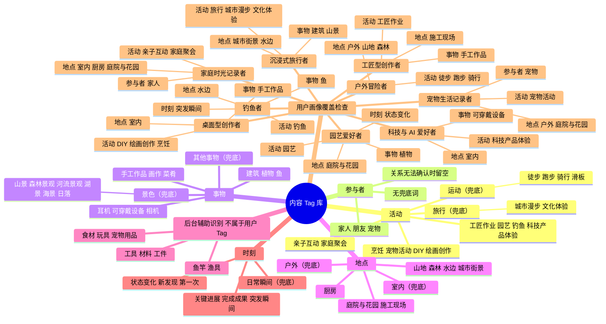

# Nexleap Tag 自建库方案（初稿）

## 内容标签组织与用户画像映射思维导图

一级逻辑大类组织用户可见词表，二级词是标准标签；一条素材或 Chapter 可以在不同大类下关联多个标签。算法辅助识别对象单独存储，不作为用户 Tag。画像分支展示各类用户对应的标签组合，用于检查词表覆盖面。画像本身不写成素材标签，也不限制用户只能属于某一类。

## 1. 建库目标

建立一套小而稳定、可逐步扩充的受控 Tag 词表，用于：

1. 给素材和 Chapter 添加可检索的内容标签；
2. 把用户的自然语言偏好映射到统一词条；
3. 在用户授权和证据充分的前提下，为后续内容排序提供偏好信号。

Tag 描述“记录里有什么、发生了什么”，用户画像描述“我们重点服务哪些类型的人”。画像用于检查词表是否覆盖产品定义中的场景，不直接成为素材 Tag，也不用于 1.0 改变设备拍摄策略。

## 2. 分类框架

Tag 库采用两层结构：**一级是逻辑大类，二级是用户能看到的标准标签**。一级逻辑大类为**活动、参与者、事物、地点、时刻**。一条记录可以跨大类关联多个二级标签，例如：

> 徒步（活动）+ 朋友（参与者）+ 山景（事物）+ 步道（地点）+ 关键进展（时刻）

不同大类之间可以组合，同一大类也可以多选。正式词表保持两层；更具体的动作、同义说法和算法属性作为别名或后台证据保存，不继续扩成第三级用户标签。

| 一级逻辑大类            | 回答的问题       | 二级用户可见标签示例    | 主要用途      |
| ----------------- | ----------- | ------------- | --------- |
| 活动 `activity`     | 正在做什么？      | 徒步、烹饪、钓鱼、园艺   | 活动检索、场景归纳 |
| 参与者 `participant` | 和谁一起？       | 家人、朋友、宠物      | 关系与共同记忆检索 |
| 事物 `subject`      | 主要关注什么？     | 植物、鱼、手工作品     | 主体检索与长期追踪 |
| 地点 `setting`      | 在什么类型的地方？   | 山地、室内、施工现场    | 场景检索      |
| 时刻 `moment`       | 这段记录值得怎样回看？ | 完成成果、第一次、状态变化 | 高光筛选、故事结构 |

二级标签都是面向用户的词语，可用于卡片展示、搜索和筛选；不代表每条内容都要把所有匹配标签同时显示。置信度、重复度、时长、相似度等算法特征是后台信号，不属于用户可见 Tag。

每个大类只在类别已确认、具体二级词无合适匹配时使用兜底词。类别本身也无法可靠识别时保持未标注；参与者维度只保留家人、朋友、宠物，无法确认关系时留空，不推断“独自”或“其他人”。

## 3. Tag 词库

下列为建议的首批标准词。每个词条都应保留稳定 ID；中文显示名可调整，ID 不随改名变化。英文项是建议的机器标识，不要求直接展示给用户。

### 3.1 活动 `activity`

| 二级用户可见标签 | 建议机器标识                 | 合并的说法或例子                                 | 兜底关系     | 覆盖画像           |
| -------- | ---------------------- | ---------------------------------------- | -------- | -------------- |
| 运动（兜底）   | `sport`                | 已确认是运动，但无法稳定区分具体运动类型                     | —        | 户外冒险者          |
| 徒步       | `hiking`               | 登山、山地徒步                                  | `sport`  | 户外冒险者          |
| 跑步       | `running`              | 越野跑                                      | `sport`  | 户外冒险者          |
| 骑行       | `cycling`              | 山地骑行                                     | `sport`  | 户外冒险者          |
| 滑板       | `skateboarding`        | —                                        | `sport`  | 户外冒险者          |
| 旅行（兜底）   | `travel`               | 观光、景点游；旅行类活动的宽泛识别                        | —        | 沉浸式旅行者         |
| 城市漫步     | `city_walk`            | Citywalk                                 | `travel` | 沉浸式旅行者         |
| 文化体验     | `cultural_exploration` | 参观博物馆、体验当地文化                             | `travel` | 沉浸式旅行者         |
| 亲子互动     | `parent_child_time`    | —                                        | —        | 家庭时光记录者        |
| 家庭聚会     | `family_gathering`     | —                                        | —        | 家庭时光记录者        |
| 烹饪       | `cooking`              | 做饭、烘焙                                    | —        | 家庭时光记录者、桌面型创作者 |
| 宠物活动     | `pet_activity`         | 遛宠、玩耍、训练、喂养、梳理、宠物出行                      | —        | 宠物生活记录者        |
| DIY（兜底） | `diy`                  | 手工制作、模型制作、模型拼装、拼图；已确认是桌面创作，但无法稳定识别更具体类型 | —        | 桌面型创作者         |
| 绘画创作     | `painting`             | 绘画、插画                                    | —        | 桌面型创作者         |
| 工匠作业     | `trade_work`           | 木工、砌筑、铺贴、电气、水管、施工、维修                     | —        | 工匠型创作者         |
| 园艺       | `gardening`            | 播种、移栽、浇水、修剪、巡园、收获                        | —        | 园艺爱好者          |
| 钓鱼       | `fishing`              | 抛投、咬钩、扬竿、遛鱼、起鱼、测量、放流                     | —        | 钓鱼者            |
| 科技产品体验   | `technology_trial`     | 设备测试、AI 工具体验                             | —        | 科技与 AI 爱好者     |

### 活动词条的粒度规则

- 二级标准词表达用户容易辨认、也可能单独检索的活动；不要把每种运动变体、操作步骤或拍摄片段都建成独立 Tag。
- 同义表达和具体做法先作为别名、活动描述或事件信息保留。例：越野跑映射到“跑步”，扬竿映射到“钓鱼”及相应事件细节。
- 运动类型无法稳定细分时回退为“运动”；旅行内容无法稳定区分为“城市漫步”或“文化体验”等细分时回退为“旅行”。能识别具体活动时优先使用具体标签，不必同时添加兜底标签。
- 只有用户确实需要分别搜索，且合并后会丢失重要含义时，才把子类升为独立标准词。

### 3.2 参与者 `participant`

| 二级用户可见标签 | 建议机器标识   | 说明               |
| -------- | -------- | ---------------- |
| 家人       | `family` | 泛称；具体关系可按用户确认后使用 |
| 朋友       | `friend` | 可由用户确认           |
| 宠物       | `pet`    | 泛称               |

参与者只提供“家人、朋友、宠物”三个用户可见标签。具体关系和身份可在用户主动提供时作为私有信息处理，不扩展为公共 Tag，也不凭画面推断。
**兜底：不标注。** 只有关系能确认属于家人、朋友或宠物时才添加参与者 Tag；看不到同行者不等于用户独自活动。

### 3.3 事物 `subject`

事物标签区分“用户能用来回看或检索的主体”和“算法为理解场景而识别的辅助物件”。只有第一类进入二级可见 Tag；辅助物件不进入用户标签列表。

#### 用户可见的事物标签

| 二级用户可见标签 | 建议机器标识             | 覆盖画像         |     |
| -------- | ------------------ | ------------ | --- |
| 景色（兜底）   | `landscape`        | 户外冒险、旅行      |     |
| 山景       | `mountain`         | 户外冒险、旅行      |     |
| 森林景观     | `forest_landscape` | 户外冒险、旅行      |     |
| 河流景观     | `river_landscape`  | 户外冒险、钓鱼      |     |
| 湖景       | `lake_view`        | 户外冒险、钓鱼      |     |
| 海景       | `ocean_view`       | 旅行、钓鱼        |     |
| 日落       | `sunset`           | 户外冒险、旅行      |     |
| 野生动物     | `wildlife`         | 户外冒险、旅行      |     |
| 建筑       | `architecture`     | 沉浸式旅行        |     |
| 地标       | `landmark`         | 沉浸式旅行        |     |
| 博物馆      | `museum`           | 沉浸式旅行        |     |
| 手工作品     | `handmade_work`    | 桌面创作者、工匠型创作者 |     |
| 画作       | `artwork`          | 桌面创作者        |     |
| 菜肴       | `dish`             | 桌面创作者、家庭生活   |     |
| 植物（兜底）   | `plant`            | 园艺爱好者        |     |
| 花        | `flower`           | 园艺爱好者        |     |
| 树        | `tree`             | 园艺爱好者        |     |
| 蔬菜       | `vegetable`        | 园艺爱好者、家庭生活   |     |
| 鱼        | `fish`             | 钓鱼者          |     |
| 设备       | `device`           | 科技与 AI 爱好者   |     |
| 软件       | `software`         | 科技与 AI 爱好者   |     |

景色细分无法稳定识别时回退为“景色”（`landscape`），例如能确认画面主体是景色、但无法判断具体类型。适用范围包括山景、森林景观、河流景观、湖景、海景和日落；野生动物不属于景色兜底。能识别具体景色时优先使用细分标签，不必同时添加“景色”。`landscape` 描述画面主体，不等同于地点标签“户外”；室内展示的风景图不因此标为户外。

#### 算法内部识别对象（不作为用户可见 Tag）

| 内部对象类别 | 识别用途示例 | 不直接展示的原因 |
|---|---|---|
| 工具、材料、工件 | 判断工匠作业阶段或项目内容 | 细节多、对多数 Chapter 标题和回看帮助有限 |
| 食材 | 辅助理解烹饪过程 | 通常比完成的菜肴更像过程证据 |
| 玩具、宠物用品 | 辅助识别家庭或宠物互动 | 通常是背景物件，用户更关心家人或宠物本身 |
| 鱼竿、渔具 | 辅助判断钓鱼场景和动作 | 属于场景证据，通常不是回忆主题 |
| 施工项目、维修对象 | 辅助区分施工或维修内容 | 可保留在内部语义索引，只有用户主动检索时再返回相关素材 |

“钓鱼”归活动、“鱼”归可见事物；“工匠作业”归活动，“工具、材料、工件”只作为内部识别对象。

### 3.4 地点 `setting`

地点 Tag 只保留从画面能较稳定辨认的粗粒度环境。需要地图、精确 GPS、用户身份或场所用途才能判断的地点不进入自动 Tag 库。

| 二级用户可见标签 | 建议机器标识              | 识别依据                           |
| -------- | ------------------- | ------------------------------ |
| 户外（兜底）   | `outdoors`          | 已确认在室外，但无法稳定识别更具体环境            |
| 山地       | `mountain_area`     | 山体地形明显                         |
| 森林       | `forest`            | 树木密集的自然环境                      |
| 水边       | `waterside`         | 画面中可见水域及岸边                     |
| 城市街景     | `city_street`       | 道路、街道与城市建筑组合                   |
| 室内（兜底）   | `indoors`           | 已确认在室内，但无法稳定识别更具体环境；不推断是否为用户家中 |
| 厨房       | `kitchen`           | 可见厨房设施和烹饪区域                    |
| 庭院与花园    | `yard_garden`       | 可见庭院或园艺空间，不推断产权或所属关系           |
| 施工现场     | `construction_site` | 可见施工环境与相关设备；低置信度时不添加           |

“景点、文化场馆、途中、客厅、家庭菜园、工作台、工作室、维修现场、钓鱼平台”等依赖地图、身份上下文或细粒度用途判断的标签，从自动地点词表中剔除。精确地点和 GPS 另行管理，不作为通用 Tag。户外和室内是本大类兜底词；如果室内外都无法判断，则不添加地点 Tag。

### 3.5 时刻 `moment`

合并同类项后，用户可见的时刻词条只保留可区分的回看价值。“里程碑”并入“关键进展”，“即时反应”并入“突发瞬间”（反应作为事件描述或识别证据），“前后对比”并入“状态变化”（对比作为呈现方式）。“值得纪念”属于用户的主观标记，不作为模型自动生成的通用 Tag。

| 二级用户可见标签     | 建议机器标识             | 展示与识别说明                                 |
| ------------ | ------------------ | --------------------------------------- |
| 关键进展         | `key_moment`       | 结合连续片段和事件发展判断；覆盖具有阶段意义的里程碑              |
| 完成成果         | `completed_result` | 呈现活动完成后的结果                              |
| 突发瞬间         | `unexpected_event` | 根据画面、声音和动作的短时变化生成候选；人物或宠物反应作为事件表现记录     |
| 状态变化         | `change`           | 适用于植物成长、项目进度等变化；同一对象的前后对比作为呈现方式，不另设 Tag |
| 新发现          | `discovery`        | 展示用户可能关注的新信息或发现                         |
| 第一次          | `first_time`       | 需用户表达、主动标记或充分的个人历史证据                    |
| 日常瞬间（兜底，不显示） | `routine_moment`   | 确认属于普通日常记录，不显示，只做后台标记                   |

时刻标签使用用户可理解的表达，但不要求每条内容都显示。“日常瞬间”不显示；时刻性质无法判断时不添加任何时刻 Tag。算法内部的突变分数等信号不直接展示。

## 4. 用户画像覆盖映射

| 产品定义画像 | 常用活动标签 | 参与者标签 | 主要可见事物标签 | 可识别地点标签 | 可见时刻标签 |
|---|---|---|---|---|---|
| 户外冒险者 | 徒步、跑步、骑行、滑板 | 朋友 | 山景、野生动物 | 户外、山地、森林 | 关键进展、完成成果、突发瞬间 |
| 沉浸式旅行者 | 旅行、城市漫步、文化体验 | 家人、朋友 | 建筑、地标、博物馆、山景 | 城市街景、水边 | 新发现、状态变化 |
| 家庭时光记录者 | 亲子互动、家庭聚会、烹饪 | 家人 | 菜肴、手工作品 | 室内、厨房、庭院与花园 | 突发瞬间、关键进展、完成成果 |
| 宠物生活记录者 | 宠物活动 | 宠物 | — | 户外、室内、庭院与花园 | 突发瞬间、完成成果 |
| 桌面型创作者 | DIY、绘画创作、烹饪 | 朋友 | 手工作品、画作、菜肴 | 室内、厨房 | 关键进展、完成成果、状态变化 |
| 工匠型创作者 | 工匠作业 | 朋友 | 手工作品 | 施工现场、室内 | 关键进展、新发现、完成成果、状态变化 |
| 园艺爱好者 | 园艺 | 家人 | 植物、花、树、蔬菜 | 庭院与花园、户外 | 状态变化、新发现、第一次 |
| 钓鱼者 | 钓鱼 | 朋友、家人 | 鱼 | 水边、户外 | 突发瞬间、完成成果、关键进展 |
| 科技与 AI 爱好者 | 科技产品体验 | 朋友 | 耳机、可穿戴设备、相机、AI 设备、软件 | 室内 | 关键进展、新发现、完成成果 |

## 5. 建库逻辑与边界

### 5.1 画像是覆盖检查表，不是 Tag 主分类

产品画像是按用户动机和需求描述的人群类型；Tag 是素材可观察、可检索的内容描述。一个用户可以同时徒步、带孩子、做园艺，因此不应被固定在单一画像 Tag 下。建库时用画像表检查活动、参与者、事物、地点和时刻是否遗漏。

### 5.2 五个逻辑大类负责回答不同问题

例如“带家人在庭院种菜，家人第一次摘下番茄”：活动是“园艺”，参与者是“家人”，事物是“蔬菜”，地点是“庭院与花园”，时刻是“第一次”。“种菜、摘番茄”作为素材描述，不再拆成更多活动 Tag。拆成大类后，既能单独搜索，也能组合检索，避免把整句话做成一个无法复用的标签。

### 5.3 控制粒度，先稳定再扩充

首版只收录能帮助检索、聚类或排序的常见概念。不同说法归并到同一标准词，例如“遛狗、带狗散步”可映射到“宠物活动”，原始说法作为别名保存。专业程度过高、频率很低的词先进入待审核区，不立即成为正式词条。

### 5.4 内容标签和用户偏好分开保存

同一个标准词可以用于内容标注或偏好记录，但两种关系不能混为一谈：

- **内容标签**：某素材/Chapter 中识别到“钓鱼”“水边”“鱼”等内容，记录模型置信度及证据来源。
- **正向偏好**：用户明确表示喜欢某类内容，或多次对相关 Chapter 点赞后形成的偏好信号。
- **负向偏好**：用户表达“不想看”的观看体验或内容特征，例如重复、冗长、过于日常、缺少事件感。用户端应使用这类自然语言原因，不要求用户理解后台活动、主体或环境标签。

点赞一条 Chapter 不应马上推断用户长期偏好其所有标签；用户跳过或不生成也不应直接推断为负向偏好。行为信号需要多次出现才可作为弱排序信号，并保留用户修改入口。

### 5.5 负向偏好从用户感受到的内容体验出发

负向偏好不是一套和正向 Tag 并列的“活动黑名单”。用户选择的是“不想看到的原因”；系统再根据素材内容与时间序列，将原因映射到可识别的内容特征。可用以下选项作为首轮用户研究和原型候选：

| 用户端表达 | 用户在回避的体验 | 后台可能参考的内容特征（非用户术语） |
|---|---|---|
| 重复的通勤片段 | 熟悉、重复、缺少新鲜感 | 通勤活动；相似场景或片段在一段时间内重复出现 |
| 过长的工作或会议片段 | 冗长、内容密度低 | 片段时长、动作/场景变化少、会议或工作语义 |
| 太多相似的瞬间 | 重复、信息增量小 | 同一用户时间范围内的视觉/语义相似度、已展示次数 |
| 日常饭食 | 过于平常、不值得回看 | 用餐/做饭相关内容及其重复频率；不能仅凭“食物”就判为无聊 |
| 只有风景的画面 | 缺少人物、行动或事件 | 风景主体占比高，且没有识别到显著人物动作或事件；尊重用户对风景本身的偏好 |
| 重复的室内日常 | 场景单一、重复、缺少变化 | 室内环境、活动与片段相似度及变化程度 |
| 让人不适或不想回看的内容 | 主观不适，具体原因因人而异 | 由用户直接选择或描述；不能由模型自行假设不适原因 |
| 暂时没有 | 当前不需要设置负向偏好 | 不建立任何回避规则 |

这些表达是“回避理由”，不应变成内容标签，也不表示相应活动本身质量低。例如，用户选择“日常饭食”后，可以降低重复、平淡餐食片段的展示优先级，但不能因此过滤生日宴、第一次做成一道菜等有意义的内容。

负向规则应能组合、限范围并撤销。例如“工作内容可以保留，但不要长时间没有变化的会议镜头”应回避“工作/会议 + 时长较长 + 变化较少”的组合，而不是屏蔽所有工作内容。隐私和安全过滤（如私密场景、遮挡人脸）属于独立设置，不与“无聊/不适”的偏好理由混用。

## 6. 词条数据结构建议

每个标准 Tag 至少包含：

| 字段 | 作用 | 示例 |
|---|---|---|
| `tag_id` | 永久稳定的机器 ID | `activity.fishing` |
| `facet` | 所属一级逻辑大类 | `activity` |
| `canonical_name` | 二级用户可见标准标签 | 钓鱼 |
| `aliases` | 后台匹配用的同义词、口语表达、英文表达 | 垂钓、去钓鱼、angling |
| `definition` | 清楚说明适用与不适用范围 | 使用鱼竿等方式进行垂钓；不含水族观赏 |
| `status` | 维护状态 | active / candidate / deprecated |
| `sensitivity` | 隐私级别提示 | ordinary / personal / sensitive |

素材和 Tag 的关联记录另存：`target_id`、`tag_id`、`confidence`、`source`（模型/用户/规则）、`evidence`、`created_at`。用户偏好关系另存：`user_id`、`preference_polarity`（喜欢/回避）、`preference_reason_id`（用户可理解的体验原因）、`target_scope`（作用范围或组合条件）、`strength`、`source`、`updated_at`。不要把变化中的偏好分值写回公共词条定义；负向理由和后台内容特征应分别维护。

## 7. 自动识别与自然语言映射

### 7.1 内容自动标注

1. 从画面、声音、设备操作和时间序列提取候选活动、参与者、事物、地点和事件变化。
2. 将候选匹配到受控词表及别名；模型可以排序候选，但不直接创建正式标准词。
3. 结合 Chapter 前后片段去重、补充关系，并保留每个逻辑大类标签的独立置信度。
4. 置信度高且风险低的标签可自动应用；中低置信度标签保持候选或不展示。关系身份及个人意义标签需要用户确认或历史证据。

### 7.2 用户自然语言映射

正向表达如“多留点我和狗去海边的日常”，可拆成“宠物活动”“宠物”“水边”等内容偏好候选，展示给用户确认。

负向表达如“不要总给我看每天差不多的通勤”，应先识别用户感受到的原因是“重复/缺少新鲜感”，再关联可能的后台特征“通勤 + 时间范围内重复出现”。如果用户说“通勤风景我喜欢，但重复片段少放”，就只降低重复片段的优先级，不屏蔽通勤或风景本身。原始表达可以作为私有偏好记录保留，映射不确定时先询问用户，不强行套用词条。

## 8. 隐私与误判约束

- 不根据脸部外观推断亲属关系、姓名、年龄或身份；关系 Tag 由用户提供或确认。
- 不把精确地点写入通用地点词表；精确位置需单独授权和设置访问控制。
- “第一次”“重要”“最难忘”等个人意义不可只凭通用模型断言。
- 对工作现场、客户、同事、家庭成员等涉及他人的内容，标签保持必要的粗粒度，并尊重产品的隐私过滤策略。
- 用户删除内容或撤回偏好后，应同步清理对应关系，避免画像继续沿用旧信号。

## 9. 推荐的 1.0 实施范围

1. 先落地五个逻辑大类和表中高频二级标签，允许跨类组合与同类多选。
2. 优先支持内容检索和 Chapter 语义分类；偏好设置从用户感受出发，先支持显式的“喜欢/不想看”理由及范围，再映射到内容特征，用于实验性排序，不用于改变拍摄频率或采集策略。
3. 自然语言输入映射到标准 Tag，结果可确认、删除或修改；新词先进候选区，定期人工合并同义词。
4. 用徒步/骑行、旅行、亲子、宠物、桌面创作、工匠施工、园艺、钓鱼、科技体验等样本做覆盖检查，观察误判、漏词和同义词，再扩充词库。
5. 词条规模不预设硬性上限；以真实检索需求、用户输入频次和模型稳定度作为扩充依据。

## 10. 与现有产品定义及会议决策的衔接

这套方案将产品定义中的九类用户画像作为覆盖基准；沿用会议中“预设标签库匹配自然语言”“偏好映射到内部 Tag”的方向；同时遵守 1.0 先使用泛化拍摄策略、暂不由用户画像驱动拍摄的结论。词条层级、自动标注阈值和偏好排序权重仍应使用真实样例和用户研究确认后再定。
